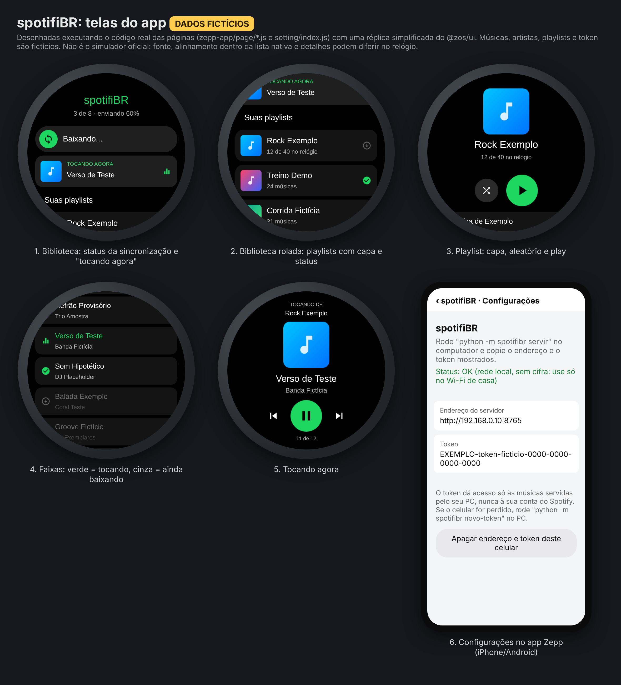
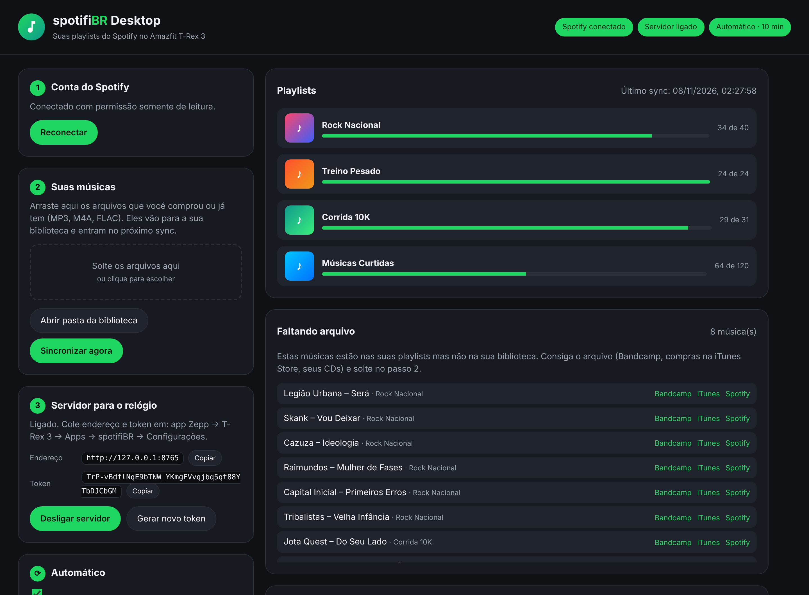

# Como usar o spotifiBR



🎬 **Vídeo de apresentação (2 min):** [docs/video/spotifibr-apresentacao.mp4](docs/video/spotifibr-apresentacao.mp4)

## Resumo em uma frase

O **Spotify diz quais músicas** vão para o relógio (suas playlists). **O áudio vem de arquivos seus**, e o spotifiBR leva só as novidades ao relógio sempre que você abre o app.

```
Spotify (suas playlists) ─┐
                          ├─> PC: trex-sync ──Wi-Fi──> iPhone: app Zepp ──Bluetooth──> Relógio: spotifiBR
Seus arquivos de música ──┘
```

## De onde vêm as músicas (o áudio)

O Spotify não permite exportar o áudio: ele é criptografado e só toca dentro do app dele. Por isso as fontes são estas:

| Fonte | Custo | Qualidade | Observação |
|---|---|---|---|
| Seus arquivos (CDs, downloads antigos) | já tem | varia | Coloque na pasta definida em `library_dirs` |
| **Bandcamp** | compra por faixa/álbum | MP3 320k ou FLAC | Sem proteção; o artista recebe a maior parte |
| **Compras na iTunes Store** (app Apple Music/iTunes) | compra | AAC 256k | Sem proteção; o trex-sync converte para MP3. Músicas da **assinatura** Apple Music são protegidas e **não** servem |
| Jamendo, Free Music Archive, Internet Archive | grátis | varia | Músicas liberadas pelos autores |

O trex-sync lê a sua playlist e gera `saida/_FALTANDO.txt`, a lista das músicas que você ainda não tem em arquivo, cada uma com o link. Use essa lista como lista de compras.

## spotifiBR Desktop (o app do computador)



Em vez de digitar comandos, abra o painel:

```bash
pip install -e ".[tags]"
spotifibr          # ou: python -m trex_sync painel
```

Ele abre no navegador, só no seu computador (`127.0.0.1`, com uma chave aleatória por sessão). Pelo painel você:

- configura Client ID, playlists, pastas e qualidade;
- clica em **Conectar Spotify** (somente leitura);
- **arrasta os arquivos de música** que você comprou ou já tem: eles vão para a biblioteca;
- vê **"Faltando arquivo"**, com botões de busca no Bandcamp, no iTunes e no Spotify;
- clica em **Sincronizar agora**, ou liga o **Automático**: ele sincroniza sozinho quando entra música nova na pasta e a cada X minutos;
- liga o **servidor para o relógio** e copia endereço e token com um clique.

Os passos abaixo continuam valendo para quem preferir a linha de comando.

## Primeira configuração (uma vez só, cerca de 30 min)

**No computador** (Windows, Mac ou Linux):

1. Instale Python 3.10+, ffmpeg e Node 18+.
2. Baixe este projeto e, na pasta dele, rode: `pip install -e ".[tags]"`
3. `cp config.example.json config.json`
4. Crie um app em https://developer.spotify.com/dashboard:
   - Redirect URI: `http://127.0.0.1:8888/callback`
   - API: Web API
   - Copie o **Client ID** para `spotify_client_id` no `config.json`.
5. No `config.json`, preencha:
   - `playlists`: links das playlists, ou `"liked"` para as Músicas Curtidas;
   - `library_dirs`: pasta onde estão seus arquivos de música.
6. `python -m trex_sync login`: o navegador abre e você autoriza. Só pede permissão de leitura.

**Instalar o app no relógio pelo iPhone:**

7. App Zepp → Perfil → Configurações → Sobre → toque 7 vezes no logo. Aparece o **Developer Mode**.
8. Crie uma conta em https://console.zepp.com, crie um Mini Program e troque o `appId` em `zepp-app/app.json` pelo seu.
9. No computador:
   ```bash
   npm i -g @zeppos/zeus-cli
   cd zepp-app
   npm install
   zeus login
   zeus preview
   ```
   Escolha o T-Rex 3; aparece um QR code.
10. No iPhone: Perfil → Developer Mode → Scan → leia o QR. O spotifiBR aparece no relógio.

**Ligar o app ao seu PC:**

11. No computador: `python -m trex_sync servir --sync`. Ele mostra o **Endereço** e o **Token**.
12. App Zepp → Perfil → T-Rex 3 → Apps → spotifiBR → Configurações. Cole o endereço e o token; o status deve ficar verde.
13. Na primeira sincronização, o iPhone pergunta se o Zepp pode acessar a rede local: **Permitir**.

## Uso no dia a dia

1. Adicione músicas às suas playlists no Spotify, como sempre.
2. Se alguma música nova ainda não estiver nos seus arquivos, ela aparece em `saida/_FALTANDO.txt`. Compre ou baixe de uma fonte legal e coloque na pasta da sua biblioteca. O nome `Artista - Título.mp3` ajuda, mas com as tags preenchidas o nome não importa.
3. No computador: `python -m trex_sync servir --sync`.
4. No relógio, abra o **spotifiBR**. Ele baixa sozinho só o que é novo:
   - mostra o progresso (`3/8 Nome da música, enviando 60%`);
   - tenta de novo até 3 vezes se a conexão cair;
   - apaga do relógio o que você tirou das playlists.
5. Mantenha o app Zepp aberto no iPhone e o spotifiBR aberto no relógio até aparecer **"Sincronização concluída"**.
6. Conecte os fones Bluetooth pelo menu do relógio, escolha a playlist e toque **Tocar** ou **Aleatório**. A música continua com a tela apagada.

## Problemas comuns

| Sintoma | Causa provável | Solução |
|---|---|---|
| "Falha: sem conexão com o app Zepp" | App Zepp fechado ou relógio desconectado | Abra o app Zepp no iPhone |
| "Token inválido" | Token digitado errado ou trocado | Copie de novo o token mostrado pelo `servir` |
| "Bloqueado por tentativas erradas" | 10 tentativas com token errado | Espere 15 min e corrija o token |
| "http só é aceito na rede local" | Endereço público com http | Use o IP da rede de casa ou HTTPS via Tailscale (`SECURITY.md`) |
| Conecta no Android mas não no iPhone | iOS bloqueando a rede local ou o http | Ajustes → Privacidade → Rede Local → Zepp; ou use Tailscale (HTTPS) |
| Música faltando no relógio | Sem arquivo local | Veja `saida/_FALTANDO.txt` |
| Transferência lenta | Bluetooth é lento (minutos por música) | Use `"mp3_bitrate": "96k"` no `config.json` |
