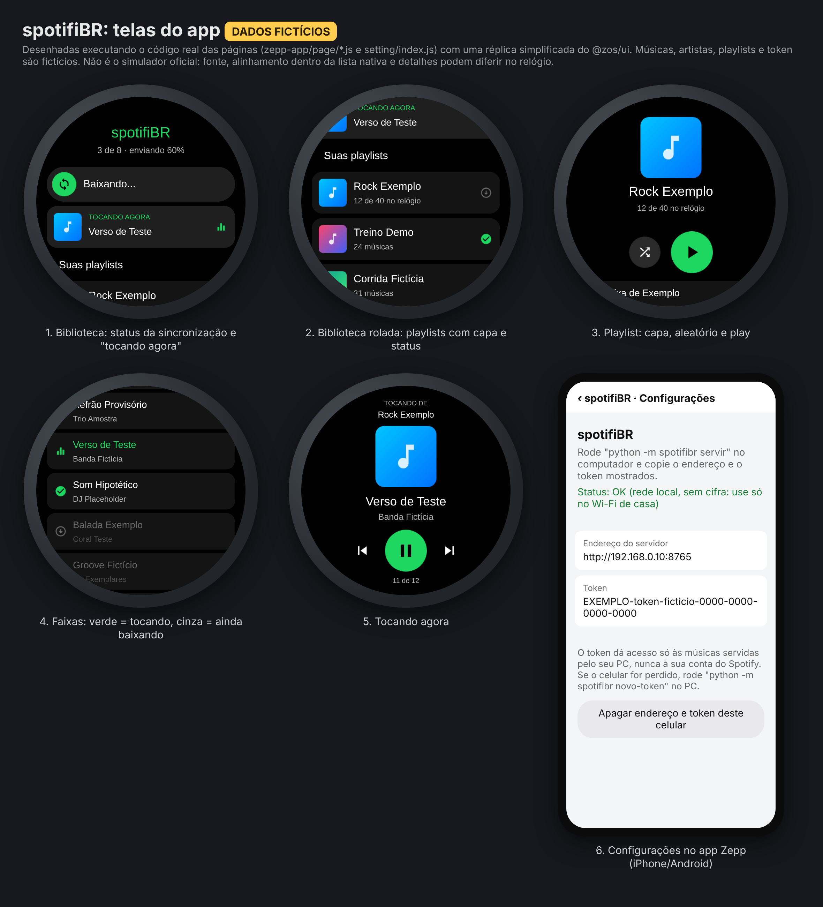

# spotifiBR: playlists do Spotify offline no Amazfit T-Rex 3



**Guia de uso passo a passo: [COMO_USAR.md](COMO_USAR.md)** · 🎬 [Vídeo de apresentação](docs/video/spotifibr-apresentacao.mp4)

O projeto tem duas partes:

| Parte | Pasta | O que faz |
|---|---|---|
| **spotifiBR Desktop** (PC, Python) | `spotifibr/` | Painel no navegador (`spotifibr`) ou linha de comando: lê suas playlists no Spotify, recebe seus arquivos, sincroniza sozinho e serve as músicas para o relógio |
| **spotifiBR** (relógio, Zepp OS) | `zepp-app/` | Ao abrir no relógio, baixa só as músicas novas pelo app Zepp e toca offline, inclusive em segundo plano. Veja [`zepp-app/README.md`](zepp-app/README.md) |

Com o app do relógio instalado, o fluxo vira: `python -m spotifibr servir --sync` no PC → abrir o spotifiBR no relógio. O passo manual de transferir pelo app Zepp e o `confirmar` deixam de existir.

## Limites (leia antes)

| Limite | Causa | Consequência |
|---|---|---|
| Não baixa o áudio do Spotify | As músicas baixadas no Spotify são criptografadas e só tocam no app dele. Não há API para exportá-las | Os MP3 vêm da **sua biblioteca local** (ou de um downloader externo configurado por você) |
| Não grava no player nativo do relógio | Mini-apps não acessam a biblioteca de música do sistema | O app **spotifiBR** (`zepp-app/`) tem player próprio e sincroniza sozinho ao ser aberto. Sem ele, o envio é manual pelo app Zepp |

## Como funciona

```
Spotify (API oficial) ──> lista das faixas de cada playlist
                               │
biblioteca local (MP3/FLAC/M4A...) ──> casamento por artista+título (aceita diferença de acento e "Remastered")
                               │
saida/<Playlist>/               espelho completo (convertido para MP3)
saida/_PARA_TRANSFERIR/<Playlist>/  SÓ as faixas novas desde a última transferência
saida/_FALTANDO.txt             faixas sem arquivo local, com link
```

Faixas removidas da playlist no Spotify aparecem como "REMOVA do relógio".

## Instalação

Requisitos: Python 3.10+ e `ffmpeg` (necessário só para converter arquivos que não são MP3). A dependência opcional `mutagen` faz o programa ler as tags dos arquivos. Sem ela, o nome do arquivo precisa estar no formato `Artista - Título`.

```bash
pip install -e ".[tags]"
cp config.example.json config.json
```

### App no Spotify (uma vez só)

1. Acesse https://developer.spotify.com/dashboard e clique em **Create app**.
2. Em Redirect URI, coloque `http://127.0.0.1:8888/callback`. Em APIs, marque **Web API**.
3. Copie o **Client ID** para `spotify_client_id` no `config.json`. Não é preciso client secret: o login usa PKCE.
4. Em `playlists`, coloque os links das playlists. `"liked"` = Músicas Curtidas.
5. Em `library_dirs`, coloque as pastas onde estão seus arquivos de música.

## Uso

```bash
python -m spotifibr login       # uma vez: abre o navegador para autorizar
python -m spotifibr sync        # gera saida/_PARA_TRANSFERIR com as faixas novas
# -> copie a pasta para o celular e transfira pelo app Zepp:
#    Perfil > T-Rex 3 > Música > Transferir (relógio no Wi-Fi acelera)
python -m spotifibr confirmar   # marca como transferidas; o próximo sync só traz novidades
python -m spotifibr status
python -m spotifibr servir --sync   # para o app spotifiBR do relógio (mesmo Wi-Fi do celular)
```

Para o app do relógio, use `mp3_bitrate` de 96k a 128k: a transferência por Bluetooth é lenta. O token do servidor é gerado automaticamente (`python -m spotifibr novo-token` troca). Veja [SECURITY.md](SECURITY.md) para o modelo de segurança e o acesso cifrado via Tailscale.

Se você rodar `sync` de novo sem `confirmar`, as pendentes continuam pendentes. Nada é duplicado.

## Downloader externo (opcional, por sua conta)

Para faixas que você não tem em arquivo, dá para configurar um comando externo em `downloader_command`. Os marcadores disponíveis são `{url}` (link do Spotify), `{dir}`, `{artist}` e `{title}`. O arquivo precisa ser salvo em `{dir}` com o nome `Artista - Título`. Exemplo com o spotDL, que busca o áudio no YouTube:

```json
"downloader_command": ["spotdl", "download", "{url}", "--output", "{dir}/{artist} - {title}.{output-ext}"]
```

Usar ferramentas desse tipo pode violar os termos de uso do YouTube/Spotify. A responsabilidade é sua. A opção vem desativada (`[]`).

## Testes

```bash
python -m unittest discover -s tests -v
```
